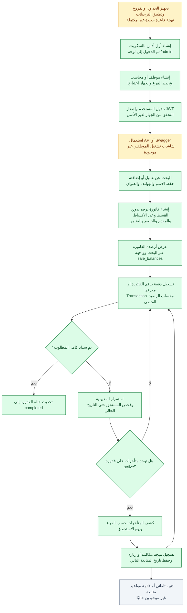
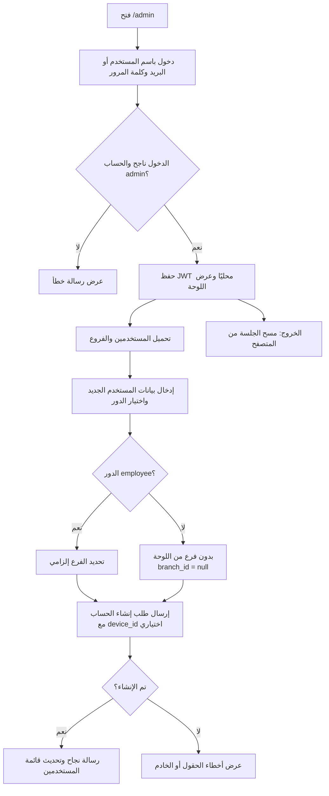
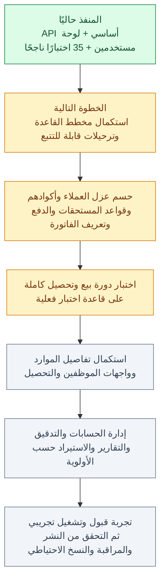

# حالة مشروع Alex وسير العمل الحالي

**تاريخ المراجعة:** 25 نوفمبر 2026 — توقيت القاهرة.

هذا التقرير مبني على الكود والملفات الموجودة حاليًا، بما فيها التعديلات المحلية غير المحفوظة في commit. يصف ما تم تنفيذه والتحقق منه محليًا؛ ولا يثبت أن نفس النسخة منشورة أو أن الترحيلات مطبقة على قاعدة البيانات الفعلية.

## 1. المشروع وصل لفين؟

المشروع نظام لإدارة البيع بالتقسيط والعملاء والضامنين وتسجيل الدفعات ومتابعة المتأخرات عبر عدة فروع.

**المرحلة الحالية: منطق العمليات الأساسي موجود في الـBackend، ومعه لوحة أولية لإدارة المستخدمين. استكمال واجهات الموظفين واختبار التكامل مع قاعدة البيانات هما الخطوتان التاليتان.**

يمكن التعامل مع دورة العميل والفاتورة والتحصيل من خلال الـAPI وSwagger. أما الواجهة الموجودة في `/admin` فمخصصة للدخول بحساب الأدمن، وإنشاء المستخدمين وعرضهم واختيار فروعهم؛ ولا توجد فيها بعدُ شاشات العملاء والفواتير والأقساط والمتأخرات.

لا توجد متطلبات شاملة أو معايير قبول محددة في المستودع تسمح بإعطاء نسبة إنجاز موثوقة، لذلك الحالة موضحة لكل جزء بدلًا من نسبة تقديرية.

| الجزء | الحالة الحالية | ما الذي يعمل أو ما حدوده؟ |
| --- | --- | --- |
| الدخول والصلاحيات | منفذ ومغطى باختبارات محلية | JWT، أدوار، إنشاء حسابات بواسطة الأدمن، وربط جهاز لغير الأدمن |
| لوحة الأدمن | منفذة لإدارة المستخدمين | دخول، إضافة مستخدم، عرض المستخدمين، تحميل الفروع، خروج محلي |
| العملاء | API منفذ | إضافة عميل وهواتف وعنوان، وتوليد كود، وبحث مع صفحات؛ عزل البحث بالفرع غير منفذ |
| فواتير التقسيط والضامن | API منفذ | إنشاء فاتورة، حساب الإجمالي، تسجيل ضامن وهواتفه داخل Transaction |
| البحث عن الفواتير | API منفذ | رقم فاتورة أو بحث عام، أرصدة، صفحات، وتقييد حسب فرع المستخدم |
| تسجيل الدفعات | API منفذ | إضافة دفعة، حساب الرصيد، وإكمال الفاتورة عند سداد المطلوب |
| المتأخرات والمتابعة | API وحساب SQL موجودان | كشف المتأخرات، آخر ملاحظة، وتسجيل موعد متابعة؛ القواعد المالية تحتاج تحققًا على بيانات فعلية |
| إنشاء قاعدة البيانات من الصفر | غير مكتمل في المستودع | ترحيلات موجودة لكنها تعتمد على جداول أعمال منشأة مسبقًا |
| استيراد Excel | غير مثبت في النسخة الحالية | ملفات Excel واعتماد `exceljs` موجودان، وسكربتات الاستيراد المذكورة في README غير موجودة |
| واجهات تشغيل الفروع والتحصيل | غير موجودة حاليًا | التعامل مع هذه العمليات يتم عبر الـAPI |
| جاهزية التشغيل الفعلي | تحتاج استكمالًا وتحققًا | الاختبارات الحالية تستخدم بيانات وهمية، ولم يُختبر نشر أو اتصال حي ضمن هذه المراجعة |

## 2. Workflow دورة العمل الأساسية

**دليل الألوان:** الأخضر = منفذ في الكود، الأصفر = موجود جزئيًا أو يحتاج تحققًا، الرمادي = مطلوب وغير موجود حاليًا. اللون الأخضر لا يعني أنه تم اختباره على قاعدة البيانات الفعلية.



### تفاصيل الخطوات المنفذة

1. **تهيئة المستخدمين:** سكربت `scripts/create-admin.js` لإنشاء أول أدمن. بعد ذلك ينشئ الأدمن المستخدمين من اللوحة أو الـAPI. الأدوار الفعلية هي `admin` و`employee` و`accountant`.
2. **الدخول:** يقبل اسم المستخدم أو البريد وكلمة المرور. الموظف والمحاسب يحتاجان `x-device-id`؛ إن لم يحدد الأدمن جهاز الحساب مسبقًا يُربط بأول جهاز يدخل به. الأدمن مستثنى من هذا الشرط. المعرف قيمة يرسلها العميل، وليس إثباتًا عتاديًا للجهاز.
3. **العميل:** عند الإضافة يُحدَّث عداد الفرع، ويُحفظ العميل وهواتفه وعنوانه في Transaction واحدة. الكود الحالي هو قيمة العداد فقط، ولا يدمج `code_prefix` معه. البحث يدعم الاسم بعد التطبيع العربي، وكود العميل والهاتف، مع ترقيم صفحات.
4. **الفاتورة:** يدخل المستخدم `invoice_number` مثل `A116` يدويًا، بينما `sales.id` لا يُمرر في استعلام الإنشاء الحالي ويُترك لتوليد قاعدة البيانات. تُحفظ تفاصيل البيع والضامن وهواتفه داخل Transaction.
5. **الدفع:** يمكن استعمال المعرف الداخلي أو رقم الفاتورة في مسار الدفع. تُقفل الفاتورة أثناء العملية بـ`FOR UPDATE`، وتُسجل الدفعة ثم يُحسب إجمالي المسدد والرصيد وتُحدَّث الحالة عند اكتمال السداد.
6. **التحصيل:** كشف المتأخرات يعرض بيانات العميل والهاتف والرصيد وآخر ملاحظة. يمكن تسجيل ملاحظة وتاريخ متابعة، لكن حفظ التاريخ وحده لا يرسل تنبيهًا أو ينفذ متابعة تلقائية.

### الحسابات الحالية في الكود

```text
إجمالي الفاتورة = المقدم + (قيمة القسط × عدد الأقساط) - الخصم
المطلوب من دفعات الأقساط = max(0, قيمة القسط × عدد الأقساط - الخصم)
إجمالي المسدد = مجموع سجلات payments للفاتورة
المتبقي = max(0, المطلوب من دفعات الأقساط - إجمالي المسدد)
```

المقدم محفوظ في الفاتورة، ولا ينشئ الكود له سجلًا تلقائيًا في `payments`. شهر الدفعة `payment_month` يُشتق من شهر تاريخ الدفع، ولا يوجد في الملفات الحالية جدول أقساط مستقل يُنشأ سجلًا لكل قسط عند البيع.

## 3. Workflow لوحة الإدارة



الواجهة عربية RTL، وتدعم إظهار كلمة المرور ورسائل التحقق وتحديث المستخدمين. إذا تعذر تحميل الفروع يمكن إدخال رقم الفرع يدويًا. الجلسة المحفوظة تُستخدم لاستعادة اللوحة عند فتحها؛ وتظل طلبات الـAPI خاضعة للتحقق من الخادم.

لا توجد حاليًا داخل اللوحة إجراءات لتعديل أو حذف مستخدم، أو إعادة تعيين كلمة المرور، أو فك ربط الجهاز، أو إنشاء وتعديل الفروع. الخروج يمسح البيانات المحلية فقط؛ لا يوجد مسار خروج لإبطال التوكن في الخادم.

## 4. المسارات الموجودة فعليًا

| الطريقة | المسار | الوظيفة والوصول |
| --- | --- | --- |
| `POST` | `/api/auth/login` | الدخول؛ الجهاز مطلوب لغير الأدمن |
| `POST` | `/api/auth/register` | إنشاء مستخدم؛ أدمن فقط |
| `GET` | `/api/auth/users` | عرض المستخدمين؛ أدمن فقط |
| `GET` | `/api/auth/branches` | عرض الفروع؛ أدمن فقط |
| `GET` | `/api/profile` | بيانات جلسة المستخدم المحميّة |
| `GET` | `/api/admin-only` | فحص صلاحية الأدمن |
| `POST` | `/api/customers` | إضافة عميل وهواتف وعنوان |
| `GET` | `/api/customers` | البحث عن العملاء مع صفحات |
| `POST` | `/api/sales` | إنشاء فاتورة تقسيط وضامن اختياري |
| `GET` | `/api/sales` | البحث عن الفواتير وعرض الأرصدة |
| `POST` | `/api/sales/:id/payments` | تسجيل دفعة بمعرف الفاتورة أو رقمها |
| `GET` | `/api/sales/overdue` | كشف المتأخرات مع الفرع ويوم الاستحقاق والصفحات |
| `POST` | `/api/sales/:id/notes` | تسجيل ملاحظة وموعد متابعة بمعرف الفاتورة أو رقمها |

مسارات الخدمة العامة: `/` تعريف بالخدمة، و`/health` حالة عملية الخادم، و`/api-docs` توثيق Swagger، و`/admin` لوحة المستخدمين. العمليات التجارية في الجدول محمية بتوكن، مع شرط الجهاز لغير الأدمن.

**تنبيه على النطاق الحالي:** مسار الفروع المنفذ هو `/api/auth/branches` للأدمن، وليس `/api/branches`. ولا توجد حاليًا مسارات تفاصيل مستقلة `GET /api/customers/:id` أو `GET /api/sales/:id`.

## 5. البنية الفنية ومكان كل مسؤولية

مسار الطلب المعتاد: **Route ← تحقق الجلسة والصلاحيات ← تحقق المدخلات ← Controller ← Service/Use Case ← PostgreSQL ← رد JSON**. وفي مسارات العملاء والمبيعات يأتي التحقق من الفرع ضمن منطق العملية.

| المسار داخل المشروع | المسؤولية |
| --- | --- |
| [src/index.js](src/index.js) | تشغيل Express، الحماية العامة، ربط المسارات، Swagger، وتقديم لوحة الأدمن |
| [src/auth/](src/auth/) | قواعد المصادقة وحالات الاستخدام ومستودع PostgreSQL وتشفير كلمات المرور |
| [src/middlewares/](src/middlewares/) | حماية الطلبات وتقييد الأدوار والتحقق بمكتبة Zod |
| [src/service/customer.service.js](src/service/customer.service.js) | إنشاء العملاء والبحث وتوليد الكود |
| [src/service/sale.service.js](src/service/sale.service.js) | الفواتير والدفعات والمتأخرات والملاحظات |
| [public/](public/) | ملفات HTML وCSS وJavaScript الخاصة بلوحة المستخدمين |
| [migrations/](migrations/) | تحديثات SQL للمستخدمين وربط الفروع وعرض الأرصدة |
| [scripts/](scripts/) | إنشاء أول أدمن، تشغيل الترحيلات، فحص الصياغة، وطلب التنشيط الدوري |
| [test/](test/) | اختبارات المصادقة والعملاء والمبيعات |

التقنيات الأساسية: Node.js، Express 5، PostgreSQL عبر `pg` مع إعداد Neon، وJWT وbcrypt وZod وSwagger. توجد إعدادات S3 لحاوية `assets`، لكن لا توجد دورة رفع ملفات مكتملة. كما توجد طلبات Keep-Alive دورية عند ضبط رابط الخادم؛ وجودها لا يثبت أن الاستضافة ستظل نشطة بعد إيقاف العملية.

## 6. ما الذي يمنع اعتبار النسخة مكتملة؟

### أ. تجهيز قاعدة البيانات وإدارة الترحيلات

- ترحيلات المستودع تنشئ `users`، لكنها تعتمد على وجود جداول الأعمال مسبقًا، ومنها `branches` و`customers` و`sales` و`payments` و`sale_notes`. لا توجد ملفات إنشاء كاملة لكل هذه الجداول.
- مشغل الترحيلات `scripts/migrate.js` ينفذ `001` إلى `005` فقط. ملف `006_sales_manual_id.sql` موجود لكنه غير مدرج في التنفيذ، ووجوده لا يجعل إدخال `sales.id` اليدوي متاحًا في API الإنشاء الحالي.
- لا يوجد سجل لتعقب الترحيلات المطبقة؛ يعيد المشغل تنفيذ قائمته كاملة. الترحيل `004` يستخدم `USING NULL` لتحويل `sale_notes.created_by_user_id` إلى UUID، ما يصفر قيم العمود عند تطبيق هذا التحويل. يلزم معالجة ذلك قبل إعادة تشغيله على بيانات فعلية.
- لم يتم في هذه المراجعة التحقق من مخطط القاعدة الحية أو الترحيلات المطبقة عليها.

### ب. استكمال عزل الفروع وقواعد الحساب

- **عزل العملاء غير مكتمل:** إنشاء العميل يستخدم فرع المستخدم لتحديث عداده، لكن استعلام حفظ العميل لا يحفظ `branch_id`، والبحث في العملاء لا يأخذ فرع المستخدم ولا يفلتر به. أما بحث الفواتير والمتأخرات والدفع والملاحظات فتطبق تقييد الفرع بالفعل.
- **توليد كود العميل يحتاج مراجعة:** الكود يستخدم عداد كل فرع دون بادئة الفرع؛ يجب حسم التفرد بين الفروع ومطابقته لقيود قاعدة البيانات.
- **المتأخرات تحتاج مطابقة قواعد العمل:** `sale_balances` يحسب عدد المستحقات من `first_installment_date` و`CURRENT_DATE`. قيمة `due_day` مستخدمة كفلتر، ولا تدخل بصورة مستقلة في حساب عدد الأقساط المستحقة. الخصم يدخل في إجمالي المطلوب والمتبقي، بينما صيغة المتأخرات الحالية لا تطرحه أو تقيد المتأخر بإجمالي المطلوب بعد الخصم.
- **التحقق يحتاج حالات إضافية:** التواريخ تُفحص بصيغة `YYYY-MM-DD` دون تحقق تقويمي كامل. ولا توجد قاعدة صريحة تمنع خصمًا أكبر من قيمة الأقساط، أو دفعًا يتجاوز الرصيد، أو دفعًا على فاتورة مكتملة/ملغاة.
- **تعريف الفاتورة للدفع يحتاج حسمًا:** المعرف الرقمي يبحث عن `id` أو `invoice_number` باستخدام `OR ... LIMIT 1`؛ إذا طابق الرقم فاتورتين مختلفتين فلا يوجد ترتيب يحسم المقصود.

### ج. واجهات ووظائف لم تُنفذ بعد

- شاشات الموظفين: العملاء، إنشاء الفواتير، البحث وعرض كشف الحساب، تسجيل الأقساط، والمتأخرات والمتابعة.
- تفاصيل العميل والفاتورة وسجل الدفعات والملاحظات وجدول السداد الكامل.
- إدارة المستخدمين بعد الإنشاء: تعديل البيانات، كلمات المرور، فك ربط الجهاز، وتعطيل الحساب. وجود شرط برمجي لفحص تعطيل الحساب لا يكفي؛ مستودع الجلسات والترحيلات لا يوفران دورة تعطيل مكتملة.
- إدارة الفروع، تقارير وتصدير Excel، وسجل تدقيق للعمليات الحساسة.
- استيراد البيانات التاريخية: ملفا `import-excel.ts` و`import-helpers.ts` المذكوران في README غير موجودين حاليًا.
- تنبيهات المتابعة التلقائية ورفع المرفقات.

### د. التحقق من التشغيل والتوثيق

- نجاح `/health` يعني أن عملية الخادم تستجيب؛ لا يعني جاهزية قاعدة البيانات. فحص بدء التشغيل يتحقق من أعمدة `users` فقط، ويستمر الخادم مع تحذير إذا فشل.
- README يحتاج مزامنة مع الكود، خصوصًا اسم دور الموظف، استثناء الأدمن من شرط الجهاز، طريقة توليد كود العميل، سكربتات Excel، ووجود لوحة الإدارة ومسارات المستخدمين والفروع والبحث عن الفواتير.
- لا يكفي نجاح الاختبارات الحالية للحكم بجاهزية الإنتاج؛ يلزم اختبار دورة كاملة بقاعدة اختبار حقيقية وتجربة الواجهة والصلاحيات.

## 7. ما تم التحقق منه أثناء هذه المراجعة

| التحقق | النتيجة | نطاق الإثبات |
| --- | --- | --- |
| `npm test` | **35 اختبارًا ناجحًا، 0 فشل** | 18 للمصادقة، 7 للعملاء، 10 للمبيعات؛ بيانات وهمية وطلبات HTTP محلية |
| `npm run build` | **نجح** | فحص صياغة ملفات JavaScript داخل `src` و`scripts` فقط |
| `node --check public/admin.js` | **نجح** | فحص صياغة كود اللوحة، دون اختبار سلوك المتصفح |
| مراجعة الملفات والمسارات | **تمت** | مقارنة الموجود فعليًا بالتوثيق وتحديد الأجزاء الناقصة |
| اتصال حي أو تشغيل migrations أو استيراد Excel | **لم يُنفذ** | حالة القاعدة الفعلية والبيانات المستوردة غير مؤكدة هنا |
| تجربة مرئية للواجهة أو نشر النسخة | **لم يُنفذ** | لا يوجد في هذه المراجعة إثبات لتشغيل النسخة المنشورة |

تغطي الاختبارات الحالية الدخول وربط الجهاز ومنع التسجيل لغير الأدمن، إنشاء العملاء والبحث، إنشاء الفواتير والدفع، إكمال السداد، المتأخرات والملاحظات، ومنع الدفع أو إضافة ملاحظة عبر الفروع. لا تختبر تنفيذ SQL على PostgreSQL حقيقي أو حساب عرض المتأخرات فعليًا.

## 8. ترتيب الاستكمال المقترح



معيار اجتياز المرحلة التالية: إنشاء قاعدة اختبار من ملفات المستودع، ثم تنفيذ دورة **أدمن ← موظف ← عميل ← فاتورة وضامن ← دفعات ← متأخرات ومتابعة ← إكمال السداد** عليها، مع إثبات عزل الفروع ومطابقة الحسابات، ثم إتاحة هذه الدورة من واجهات الاستخدام.
